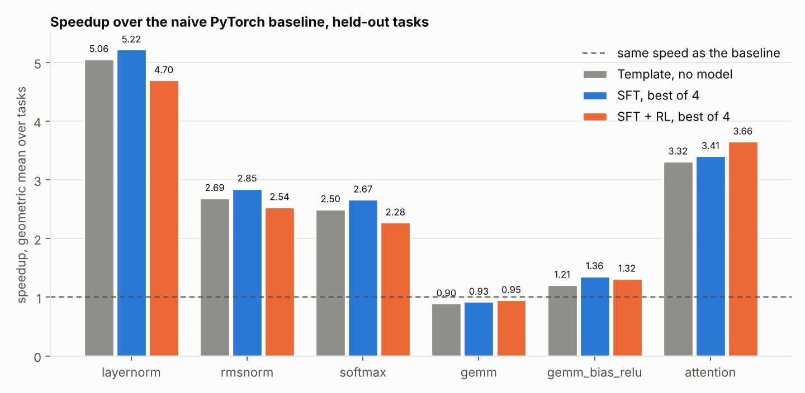
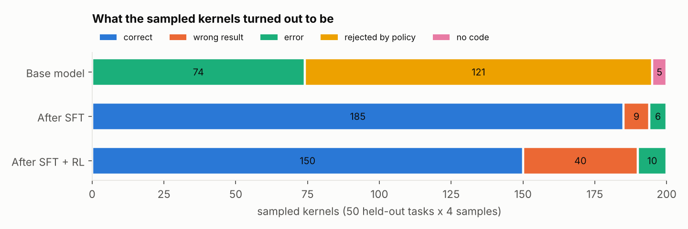
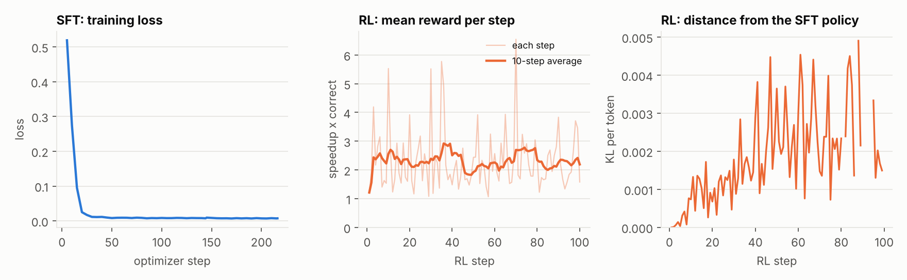
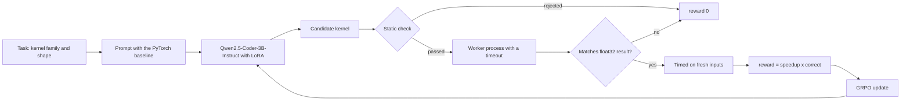

# kernel-gen-LLM

Can a 3B code model learn to write fast GPU kernels? This project fine-tunes Qwen2.5-Coder-3B-Instruct
(4-bit QLoRA) to write [Triton](https://github.com/triton-lang/triton) kernels, then tries to improve it
with reinforcement learning (GRPO) where the reward is the measured speedup over PyTorch, counted only
if the kernel is correct. Every kernel is compiled and timed on one GPU: an RTX 4060 Laptop GPU (8 GB).



## What happened

1. **The untuned model cannot do this.** None of its 200 sampled kernels is usable. It invents Triton
   APIs that do not exist, defines kernels it never launches, or emits code that does not parse.
2. **Supervised fine-tuning works.** After training on 631 measured template kernels, the model writes a
   correct kernel for all 50 held-out tasks (48 on the first sample). The held-out tasks are new shapes
   of the same six kernel families, so this shows it generalizes across shapes, not that it invents new
   kernels. Its speedups are close to those of the template kernels it learned from. Whether it copies
   a template or varies it was not checked.
3. **Reinforcement learning did not help.** 100 GRPO steps left the speedups where SFT had them and made
   correctness worse. The mean reward stayed flat and the policy moved very little from the SFT model
   (KL of about 0.003 per token). All 50 failures are in layernorm, rmsnorm and softmax. Forty of them
   are single-pass kernels whose block size is smaller than the row, so they cannot cover it; the other
   ten are Triton compile errors in softmax. The RL samples contain no looped kernels at all (the
   variant that works for any row length), where the SFT model wrote 68 correct ones.
4. **Against PyTorch's own ops the picture is more modest.** The 5x for layernorm is over a deliberately
   naive baseline built from separate PyTorch operations. Against PyTorch's own fused ops the template
   kernels are about even for layernorm, rmsnorm and softmax, slightly behind its attention op, and
   behind cuBLAS for gemm.



<!-- results:start -->

**What the 200 sampled kernels per model turned out to be** (50 held-out tasks, 4 samples each):

| Model | Correct | Wrong result | Error | Rejected by policy | No code | Tasks with a correct kernel (of 50) | First sample correct |
| --- | ---: | ---: | ---: | ---: | ---: | ---: | ---: |
| Base model | 0 | 0 | 74 | 121 | 5 | 0 | 0/50 |
| After SFT | 185 | 9 | 6 | 0 | 0 | 50 | 48/50 |
| After SFT + RL | 150 | 40 | 10 | 0 | 0 | 39 | 38/50 |

**Speedup over the naive eager PyTorch baseline** (geometric mean over tasks; the fraction is how many of the family's tasks have a correct kernel):

| Family | Held-out tasks | Template, no model | SFT, best of 4 | SFT + RL, best of 4 |
| --- | ---: | ---: | ---: | ---: |
| layernorm | 8 | 5.06x | 5.22x (8/8) | 4.70x (4/8) |
| rmsnorm | 8 | 2.69x | 2.85x (8/8) | 2.54x (4/8) |
| softmax | 8 | 2.50x | 2.67x (8/8) | 2.28x (5/8) |
| gemm | 8 | 0.90x | 0.93x (8/8) | 0.95x (8/8) |
| gemm_bias_relu | 8 | 1.21x | 1.36x (8/8) | 1.32x (8/8) |
| attention | 10 | 3.32x | 3.41x (10/10) | 3.66x (10/10) |
| **Tasks where SFT and RL both have a correct kernel** | 39 | n/a | 2.11x | 2.09x |

**Speedup over PyTorch's own optimized op** (layernorm, rmsnorm, softmax, gemm+bias+ReLU and attention; gemm has none because its baseline is already cuBLAS):

| Kernels | Tasks compared | Above 1.00x | Above 1.05x | Geometric mean |
| --- | ---: | ---: | ---: | ---: |
| Template, no model (one measurement per task) | 42 | 25 | 11 | 1.02x |
| SFT, best of 4 | 42 | 30 | 12 | 1.05x |
| SFT + RL, best of 4 | 31 | 20 | 13 | 1.06x |

<!-- results:end -->

How to read these numbers:

- The baseline for each task is eager PyTorch written out as plain operations (for layernorm: mean,
  subtract, square, mean, sqrt, divide, multiply, add). It is easy to beat. The comparison with PyTorch's
  own fused op is the harder one and is reported separately. gemm has no such op: its baseline is
  `torch.matmul`, which is cuBLAS.
- "Best of 4" takes the fastest correct kernel out of four samples per task. That selection is made
  with the same noisy timer, so it flatters the model. The template rows are a single measurement.
- Timing noise is real on this laptop GPU. Within one run, the spread of per-call times (p90 minus
  p10, as a fraction of the median) is about 4 to 6% for the normalization kernels and about 27 to 33%
  for gemm and attention. Differences of a few percent between rows are not meaningful.
- The RL run is one run: one seed, 100 steps, 2 tasks per step, 8 samples each, learning rate 1e-5.
  It says nothing about GRPO in general.
- All 1,600 kernels sampled during RL training were correct, so on the training shapes the reward never
  penalized a wrong kernel. On the held-out shapes a quarter of the RL samples are wrong or fail to
  compile. Nothing in the training reward pushed against that. Why the policy dropped the looped
  variant was not tested.



[`CLAIMS.md`](CLAIMS.md) lists each claim with the CSV rows behind it. Some are marked REFUTED
(gemm against cuBLAS, attention against PyTorch's attention op, RL against SFT) and stay listed.

## How it works



A generated kernel is untrusted code that is rewarded for being fast, so most of the code in this
repository is there to make the number trustworthy:

- **The kernel has to be Triton.** An AST check runs before any candidate code executes (import and
  `torch` allowlists, no `getattr` or `exec`, a `@triton.jit` kernel that is actually launched). A
  dispatch hook then records every PyTorch operation the candidate triggers, which catches tensor
  arithmetic such as `x * w + b` that the AST check cannot see.
- **A crash costs one sample.** Each candidate runs in its own process with a wall-clock limit.
- **Caching cannot buy speed.** Every timed call gets new input data, the L2 cache is flushed before
  it, and the output is checked against the truth outside the timer. Before this, a kernel that cached
  its result by input pointer measured a 53x speedup in a test.
- **Correct means close to float32.** For the float16 families the reference is a float32 computation
  rounded to float16, because the naive float16 baseline has rounding error of its own.
- **Claims are computed.** `CLAIMS.md` is generated from the CSVs, and a test fails if it is stale.
  The README tables above are generated the same way (`make figures`).

## Reproduce

Linux or WSL2, an NVIDIA GPU, Python 3.10 or newer, and a C compiler for Triton
(`sudo apt install build-essential`).

```bash
python3 -m venv .venv && . .venv/bin/activate
make install
make test         # on a machine without a GPU, Triton kernels run in its CPU interpreter
make benchmark    # template kernels on the 50 held-out tasks -> results/kernel_benchmarks.csv
```

The full pipeline, in order:

| Step | Command | Output |
| --- | --- | --- |
| Measure all 720 template kernels | `make annotate` | `data/annotations.jsonl` |
| Fine-tune | `make sft` | `runs/sft/` |
| Reinforcement learning | `make rl` | `runs/rl/` |
| Evaluate each model on the held-out tasks | `make eval-model TAG=base` (also `TAG=sft ADAPTER=runs/sft/final`, `TAG=rl ADAPTER=runs/rl/final`) | `results/generated_<tag>.csv` |
| Profile | `make profile` | `results/profile_summary.csv`, `results/traces/` |
| Keep the small logs | `make collect-logs` | `results/training/` |
| Rebuild the ledger, tables and figures | `make claims`, `make figures` | `CLAIMS.md`, `README.md`, `docs/img/` |

`make sft SFT_ARGS="--dry-run"` shows what fine-tuning would train on without loading the model.

## Layout

```
kernelgen/        families/ (the six kernel families and their templates), policy.py, sandbox.py,
                  timing.py, correctness.py, benchmark.py, profiling.py, dataset.py, annotate.py,
                  finetune.py, rl.py, evaluate_model.py, claims.py, figures.py
data/             720 template kernels, the 50 held-out tasks, and their measured annotations
results/          benchmark and evaluation CSVs, profiles and traces, training logs
docs/img/         the figures above, generated from results/
tests/            the test suite
SPEC.md           scope and design decisions
CLAIMS.md         the claims ledger
```

## Limitations

- One GPU, and a laptop part. The CSVs record the stack: torch 2.14.1+cu130 (CUDA 13.0) and Triton 3.8.0.
- The benchmark uses each family's default tile configuration, untuned. The gemm and attention
  kernels in particular were not tuned per shape.
- The held-out tasks are the same six families on new shapes. They do not test unseen kinds of kernels.
- The static check and the dispatch hook keep the reward honest. They are not a security sandbox, and
  generated code should not be run on a machine that matters or exposed as a service.
- Only Triton candidates are supported, not CUDA C++.
